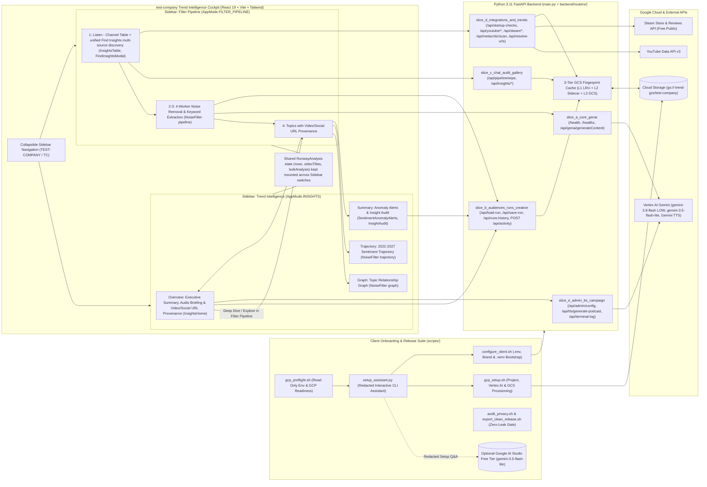

# test-company Trend Intelligence (`trend-finder`)

**test-company Trend Intelligence** (`trend-finder`) is a streamlined, brand-neutral **Deep Media Listening & Trend Intelligence** cockpit powered by **React 19 + Vite + Tailwind CSS** on the frontend and a **Python 3.11 FastAPI** backend integrated with **Vertex AI Gemini 3.8 Flash**, **Gemini 3.5 Flash-Lite**, **Gemini TTS**, **YouTube Data API v3**, **Steam Store & Reviews API** (free public endpoints, no API key required), and **Google Cloud Storage (GCS)** 3-tier fingerprint caching.

---

## Core Capabilities

1. **Sidebar Split: Trend Intelligence vs. Filter Pipeline (`RunwayAnalysis`)**: The Sidebar holds two workflows. **Trend Intelligence** shows Overview, Graph, Trajectory, and Summary. **Filter Pipeline** runs Listen, noise removal, and topic extraction. Both share one mounted state, so switching keeps loaded rows and analyses.
2. **Multi-Channel Media Listening (`InsightsTable`, `FindInsightsModal`)**: Harvests and analyzes live community signals across YouTube videos, YouTube Shorts, Steam Store catalog & reviews (no API key required), Reddit threads, Trustpilot reviews, Metacritic structured JSON-LD pages, and web sources.
3. **4-Worker Concurrent Noise Filter & Taxonomy Induction (`NoiseFilter`)**: Runs a parallel Gemini analysis queue to filter noise, extract top keywords, induce dynamic taxonomy clusters, build an interactive topic relationship graph, and project longitudinal sentiment trajectories (2022–2027).
4. **Executive Intelligence & Audio Briefings (`InsightsHome`, `SentimentAnomalyAlerts`, `InsightAudit`)**: Synthesizes executive takeaways, surfaces sentiment anomalies, ranks retail media and ad opportunities, and generates spoken executive briefings via Gemini TTS.
5. **Startup Readiness & 3-Tier GCS Fingerprint Cache (`startup_and_url_resolver_routes.py`, `backend/core_modules/`)**: Probes GCS bucket connectivity and content, YouTube/Gemini keys, free Steam Store availability, and Filter Pipeline items via `/api/startup-checks`, backed by an L1 LRU cache, L2 local mirror, and L3 GCS blob I/O for instant **Load Last** hydration.
6. **Client Onboarding, AI Setup Assistant & Clean Release Suite (`scripts/`)**: Provides read-only environment diagnostics (`gcp_preflight.sh`), guided GCP provisioning (`gcp_setup.sh`), interactive `.env` and brand setup (`configure_client.sh`), an AI Setup Assistant powered by `gemini-3.5-flash-lite` (`setup_assistant.py`), and automated privacy/secret auditing and clean release export (`audit_privacy.sh`, `export_clean_release.sh`).

---

## System Architecture



---

## 3-Step Client Onboarding

### Step 1: Check Environment Readiness
Run the read-only preflight check to inspect Node.js, Python 3, `.venv`, `gcloud` authentication, enabled GCP APIs, GCS bucket status, and `.env` presence without exposing any secret values:

```bash
npm run setup:check
```

### Step 2: Configure GCP, Brand & Local `.env` (With Optional AI Assistant)
You can launch the interactive AI Setup Assistant (`gemini-3.5-flash-lite`) or run the guided provisioning and configuration scripts directly:

```bash
# Option A: Interactive AI Setup Assistant (walks through preflight, Q&A, and setup scripts)
npm run setup:assist

# Option B: Direct GCP provisioning + local .env & dependency configuration
npm run setup:gcp
npm run setup
```

- `npm run setup:gcp` (`./scripts/gcp_setup.sh`) authenticates `gcloud`, verifies project billing, enables `aiplatform.googleapis.com` and `storage.googleapis.com` (plus optional `youtube.googleapis.com` and Cloud Run APIs), and creates the `gs://<GCP_PROJECT>-trend-gcs` bucket.
- `npm run setup` (`./scripts/configure_client.sh`) creates `.venv`, installs Python and npm packages, sets your active `COMPANY_NAME` and `.env` variables, and backs up any existing `.env` before writing.

### Step 3: Start & Verify the Local Application
`scripts/server_control.sh` manages the local stack without hardcoding or killing foreign processes on port `8080`. It resolves free ports for FastAPI (`.run/server.port`, scanning `8080..8100`) and Vite HMR (`.run/vite.port`, scanning `3000..3020`):

```bash
npm start
# Or run in background daemon mode:
./scripts/server_control.sh start --daemon
./scripts/server_control.sh status
npm run logs
npm run stop
```

---

## Automated Setup & Deployment with Antigravity CLI (`agy`)

You can use the **Google Antigravity CLI (`agy`)** to automate GCP project creation, local setup, verification, Git push, and Cloud Run deployment from your terminal.

### 1. Install and Verify `agy`

Choose the installer for your OS:

- **macOS / Linux**:
  ```bash
  curl -fsSL https://antigravity.google/cli/install.sh | bash
  ```
- **Windows (PowerShell)**:
  ```powershell
  irm https://antigravity.google/cli/install.ps1 | iex
  ```
- **Windows (CMD)**:
  ```cmd
  curl -fsSL https://antigravity.google/cli/install.cmd -o install.cmd && install.cmd && del install.cmd
  ```

If you already have the Antigravity desktop app installed on macOS, the CLI binary is at `~/.antigravity/antigravity/bin/agy` (add `~/.antigravity/antigravity/bin` to your `PATH` if `agy` is not found).

Verify the installation (launching `agy` prompts you to sign in with your Google account on first run):

```bash
agy --version
```

### 2. Launch `agy` in the Repository

Open the repository interactively, or send a prompt directly from the terminal with `agy chat` (which uses `agent` mode by default):

```bash
cd trend-finder && agy .
# Or send a prompt directly from the terminal:
agy chat "<prompt>"
```

### 3. Copy-Paste Setup, Verification & Deployment Prompt

Replace `<YOUR_PROJECT_ID>`, `<YOUR_GIT_REPO_URL>`, and `<YOUR_EMAIL>` (or let `agy` ask you interactively), then paste this prompt into `agy`:

```text
Set up, verify, push, and deploy this trend-finder repository to Google Cloud:

1. Check gcloud CLI authentication and Application Default Credentials. If needed, guide me through `gcloud auth login` and `gcloud auth application-default login`.
2. Create a new GCP project `<YOUR_PROJECT_ID>` (or use my existing project), link an active billing account, and export `GCP_PROJECT=<YOUR_PROJECT_ID>`.
3. Run `./scripts/gcp_setup.sh --with-cloud-run` and `./scripts/configure_client.sh` (or `npm run setup`) to enable Vertex AI, Cloud Storage, YouTube Data API v3, Cloud Run, Cloud Build, Artifact Registry, and Secret Manager, create the GCS cache bucket, and populate `.env` plus brand config (prompting me for `YOUTUBE_API_KEY` and Gemini provider keys if missing).
4. Verify the app with `npm run typecheck`, `npm test`, `.venv/bin/pytest`, and `npm run build`. Then start it locally (`./start_local.sh --daemon`) and confirm `/health` returns HTTP 200.
5. Point Git to my own repository (`git remote set-url origin <YOUR_GIT_REPO_URL>`, or run `npm run export:client -- ../trend-finder-client --init-git` for a clean history) and push to my remote.
6. Deploy to Cloud Run with IAM authentication (`CLOUD_RUN_AUTH_MODE=iam ./cloud_run.sh`) and bind `roles/run.invoker` for `<YOUR_EMAIL>` (or configure IAP for browser access).
```

---

## Google AI Studio Free Endpoint (`gemini-3.5-flash-lite`) vs. Vertex AI

`trend-finder` separates **CLI onboarding assistance** from **production media listening runtime**:

| Capability / Constraint | Google AI Studio Free Tier (`AI_STUDIO_API_KEY`) | Google Cloud Vertex AI (`GENAI_PROVIDER=vertex`) |
| :--- | :--- | :--- |
| **Recommended Use** | Interactive CLI setup (`npm run setup:assist` with `gemini-3.5-flash-lite`) before GCP is provisioned | Full `trend-finder` application runtime, 4-worker Noise Filter, and client deployments |
| **Bootstrap Simplicity** | Zero GCP project required; works immediately with a free key from `https://aistudio.google.com/apikey` even before `.venv` is installed | Uses `GCP_PROJECT` + Application Default Credentials (`gcloud auth application-default login`) or `GOOGLE_CLOUD_API_KEY` |
| **Data Governance & Privacy** | Unpaid tier prompts may be reviewed by human reviewers and used for model training; never send proprietary customer data | Enterprise data governance: customer prompts and outputs are never used to train Google models |
| **Regional Availability** | Free tier is unavailable in the EEA, UK, and Switzerland (requires paid billing in those regions) | Supported across global and regional Google Cloud endpoints |
| **Rate Limits & Concurrency** | ~15 RPM free-tier ceiling; throttles under the 4-worker concurrent Noise Filter queue | Enterprise RPM/TPM quotas built for parallel 4-worker pipeline execution |
| **Storage & Identity** | Does not authenticate Google Cloud Storage (`gs://`) or Cloud Run IAM | Native integration with 3-tier GCS fingerprint cache (`gs://<project>-trend-gcs`) and Cloud Run |

---

## Exporting a Clean Client Copy

Before sharing or delivering the repository to an external client, run the privacy audit and clean release exporter:

```bash
# 1. Scan tracked files and workspace for API keys, tokens, workstation paths, or brand leaks
npm run audit:privacy

# 2. Export a clean, standalone git repository with zero commit history or local state
npm run export:client -- ../trend-finder-client --init-git
```

`export_clean_release.sh` automatically runs `./scripts/audit_privacy.sh --tracked-only` before archiving, strips `.env`, `.venv`, `.run`, and git worktree metadata, initializes a fresh `main` branch when `--init-git` is passed, and verifies the exported repository with `--strict-git-history`.

---

## Engineering & Operating Standards

- **Zero Silent Fallbacks**: All Vertex AI Gemini calls, YouTube Data API v3 requests, and unmatched `/api/*` routes surface real HTTP errors and diagnostics rather than substituting synthetic mock data on failure.
- **Server-Side Key Isolation**: API keys are resolved strictly on the FastAPI backend (`GOOGLE_CLOUD_API_KEY`, `AI_STUDIO_API_KEY`, `YOUTUBE_API_KEY`) and are never exposed via frontend bundles or public `/api/key` routes.
- **Modular File Hygiene**: Every backend module, router, and shell script is modularized by domain responsibility (`<= 400` lines per file).
- **Authenticated Cloud Run Deployment**: Deploy with `CLOUD_RUN_AUTH_MODE=iam ./cloud_run.sh` (`--no-allow-unauthenticated`) so Cloud Run requires real authentication instead of public unauthenticated access, with API keys bound from Secret Manager.

---

## Cloud Run Authentication & IAM

For production or client deployments, require IAM or IAP authentication and grant least-privilege roles to the runtime service account.

### 1. Provision Least-Privilege Runtime IAM
Run the GCP setup script with `--with-cloud-run`:

```bash
./scripts/gcp_setup.sh --with-cloud-run
```

This enables Cloud Run, Cloud Build, Artifact Registry, and Secret Manager, and grants the runtime service account (`<PROJECT_NUMBER>-compute@developer.gserviceaccount.com`) only the roles required by `trend-finder`:
- `roles/aiplatform.user` on the project for Vertex AI Gemini requests.
- `roles/storage.objectAdmin` scoped to `gs://<GCP_PROJECT>-trend-gcs` for the 3-tier GCS cache.
- `roles/logging.logWriter` on the project for Cloud Logging.
- `roles/secretmanager.secretAccessor` on Secret Manager keys (`YOUTUBE_API_KEY`, `GOOGLE_CLOUD_API_KEY`, `GEMINI_API_KEY`), applied by `cloud_run.sh` when secrets are stored.

For stricter isolation, create a dedicated runtime service account instead of the default Compute Engine service account and pass `--service-account` during deployment.

### 2. Deploy Without Public Unauthenticated Access
`cloud_run.sh` defaults `CLOUD_RUN_AUTH_MODE` to `public` (`--allow-unauthenticated`) unless overridden. Always pass `CLOUD_RUN_AUTH_MODE=iam` to enforce `--no-allow-unauthenticated`:

```bash
CLOUD_RUN_AUTH_MODE=iam ./cloud_run.sh
```

### 3. Grant Caller Access (`roles/run.invoker`) or Enable IAP / OAuth
- **IAM users or service accounts**: Grant `roles/run.invoker` to authorized principals only:
  ```bash
  gcloud run services add-iam-policy-binding trend-finder \
    --region="${GCP_REGION:-us-central1}" \
    --project="$GCP_PROJECT" \
    --member="user:<user@example.com>" \
    --role="roles/run.invoker"
  ```
- **Browser users**: Place the Cloud Run service behind an Application Load Balancer with **Identity-Aware Proxy (IAP)** and OAuth enabled (or an OAuth-authenticated reverse proxy) so users sign in with corporate or client credentials rather than exposing unauthenticated public ingress.
